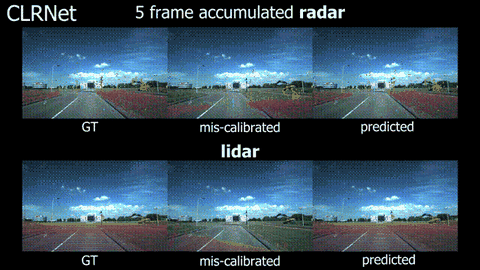
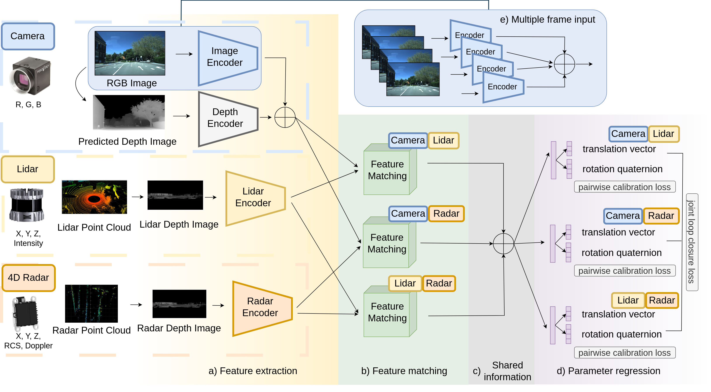

<div align="center">

<h1>CLRNet</h1>

Targetless Extrinsic Calibration for Camera, Lidar and 4D Radar Using Deep Learning

[](https://www.linux.org/)
[](https://www.docker.com/)
[](https://www.python.org/downloads/)
[](https://doi.org/10.5281/zenodo.24199767)
[](LICENSE)



</div>

Official implementation of the IEEE Transactions on Intelligent Vehicles paper
*"CLRNet: Targetless Extrinsic Calibration for Camera, Lidar and 4D Radar Using Deep Learning"*
by Marcell Kégl, Andras Palffy, Csaba Benedek and Dariu M. Gavrila.

## 📄 Overview

CLRNet is an end-to-end network for targetless extrinsic calibration of camera, lidar and 4D radar. It estimates
all three sensor-pair extrinsics jointly in a shared feature space, which also improves camera–radar
calibration over a pairwise model. It can also be used for pairwise calibration (CRNet, CLNet).

<div align="center">



CLRNet architecture. The lidar and radar point clouds are projected with equirectangular projection before
(a) feature extraction. After the pairwise (b) feature-matching layers, the outputs are (c) concatenated so that
the (d) parameter-regression layers for all three sensor pairs share information from every sensor.

</div>

## 🏆 Results

Mean errors on the View-of-Delft test split. See the paper for medians, confidence intervals and baselines.

**±20 cm / ±1° initial miscalibration, one model, per-frame:**

| Method | Camera–Radar transl. (cm) | Camera–Radar rot. (°) | Camera–Lidar transl. (cm) | Camera–Lidar rot. (°) |
|---|---|---|---|---|
| CRNet (ours)  | 11.3 | 0.6 | – | – |
| CLRNet (ours) | **9.1** | **0.4** | **4.7** | **0.1** |

**±100 cm / ±20° initial miscalibration, four-stage iterative refinement:**

| Setting | Method | Camera–Radar transl. (cm) | Camera–Radar rot. (°) | Camera–Lidar transl. (cm) | Camera–Lidar rot. (°) |
|---|---|---|---|---|---|
| per-frame | CRNet (ours)  | 14.7 | 0.8 | – | – |
| per-frame | CLRNet (ours) | **12.0** | **0.5** | **4.8** | **0.1** |
| rigid rig | CRNet (ours)  | 1.9 | 0.2 | – | – |
| rigid rig | CLRNet (ours) | 1.8 | 0.1 | **0.2** | 0.1 |
| rigid rig | CLRNet+4 (ours) | **0.9** | **0.1** | 0.3 | **<0.05** |

*Rigid rig*: one extrinsic aggregated over the test sequence; *CLRNet+4*: four input frames. The rigid-rig
CLRNet cascades are 100 cm → 50 cm → 5 cm (CLRNet+4 replaces the last model); the CRNet cascade also includes the
20 cm model.

## 💿 Datasets

### View-of-Delft

1. Request the dataset at https://intelligent-vehicles.org/datasets/view-of-delft/. The paper uses the extended
   set with 29,634 frames: the first 25,000 for training, the next 3,300 for validation and the last 1,334 for
   testing.
2. Place it under the data folder that `run.sh` mounts at `/home/appuser/data`:

```
<data>/KITTI_Second_TIER_05_29/uvod/
├── lidar/training/
│   ├── image_2/        # *.jpg
│   ├── velodyne/       # *.bin, 4 floats per point
│   ├── calib/
│   └── depthV2/        # generated on first run
├── radar/training/     # single-scan radar (optional)
└── radar_5frames/
    ├── ImageSets/      # our splits, see step 3
    └── training/
        ├── velodyne/   # *.bin, 7 floats per point
        └── calib/
```

3. Copy our splits and the fixed test miscalibrations into place:

```bash
DATA=/path/to/data/KITTI_Second_TIER_05_29/uvod
SRC=calibration/CLRNet/datasets
mkdir -p $DATA/radar_5frames/ImageSets
cp $SRC/splits/view_of_delft/*.txt $DATA/radar_5frames/ImageSets/
cp -r $SRC/miscalibrations/view_of_delft/. $DATA/
```

### Dual-Radar

Download it from the [Dual-Radar](https://github.com/adept-thu/Dual-Radar) project, place it under
`<data>/DualRadar/` and copy our splits and test miscalibrations:

```bash
mkdir -p /path/to/data/DualRadar/lidar/ImageSets
cp calibration/CLRNet/datasets/splits/dual_radar/*.txt /path/to/data/DualRadar/lidar/ImageSets/
cp -r calibration/CLRNet/datasets/miscalibrations/dual_radar/. /path/to/data/DualRadar/
```

## 💾 Install

Everything runs inside Docker and needs an NVIDIA GPU.

Prerequisites: [Docker](https://docs.docker.com/engine/install/ubuntu/) with the
[post-installation steps](https://docs.docker.com/engine/install/linux-postinstall/), an NVIDIA driver and the
[NVIDIA Container Toolkit](https://docs.nvidia.com/datacenter/cloud-native/container-toolkit/install-guide.html).

```bash
git clone --recursive https://github.com/tudelft-iv/CLRNet.git   # --recursive pulls Depth-Anything-V2
cd CLRNet
./compile.sh                      # builds clr_calibration:latest, downloads the Depth-Anything-V2-Large weights
CLR_DATA=/path/to/data ./run.sh   # starts the container; CLR_DATA defaults to ./data
docker exec -it clr_calibration bash
```

Inside the container, once per container:

```bash
pip3 install -r /home/appuser/src/calibration/CLRNet/requirements.txt   # also builds the CUDA correlation layer
export PYTHONPATH=$PYTHONPATH:/home/appuser/src/calibration/CLRNet:/home/appuser/src/calibration
```

## 🔨 Usage

On first use, camera depth maps are generated once with Depth-Anything-V2 and cached on disk.

### Train

Each script reads its settings from a YAML file in `calibration/CLRNet/configs/`.

```bash
python3 /home/appuser/src/calibration/CLRNet/train_CLR_multiple_input.py          # CLRNet (configs/VOD_CLR_config.yaml)
python3 /home/appuser/src/calibration/CLRNet/eval/train_CR_multiple_input.py      # CRNet  (configs/VOD_CR_config.yaml)
python3 /home/appuser/src/calibration/CLRNet/eval/train_CR_Dual.py                # CRNet on Dual-Radar
```

Training scripts for the baselines are in `eval/`; ablation configs are in `configs/ablations/`.

### Pretrained models

Download the checkpoints from [Zenodo](https://doi.org/10.5281/zenodo.24199767) into `<data>/checkpoints/` and check them
with `sha256sum -c SHA256SUMS`. You only need the files of the model you evaluate. Each one stores the settings
it was trained with, so the scripts configure themselves from the checkpoint. Names give the model, the
training data and the miscalibration range the model corrects.

| Model | Checkpoints (coarse to fine) |
|---|---|
| CLRNet, View-of-Delft | `clrnet_vod_{200cm_180deg, 100cm_20deg, 50cm_5deg, 20cm_1deg, 5cm_0.5deg}.pth` |
| CLRNet+4, View-of-Delft | `clrnet4_vod_5cm_0.5deg.pth` (last stage of the rigid-rig cascade) |
| CRNet, View-of-Delft | `crnet_vod_{200cm_180deg, 100cm_20deg, 50cm_5deg, 20cm_1deg, 5cm_0.5deg}.pth` |
| CRNet, Dual-Radar | `crnet_dualradar_{150cm_20deg, 100cm_10deg, 50cm_5deg, 20cm_2deg, 10cm_1deg}.pth` |

### Evaluate

```bash
# CLRNet, four-stage cascade from ±100 cm / ±20°
python3 /home/appuser/src/calibration/CLRNet/eval/eval_CLR.py

# a single model, e.g. CRNet at ±20 cm / ±1°
CLR_WEIGHTS=/home/appuser/data/checkpoints/crnet_vod_20cm_1deg.pth \
    python3 /home/appuser/src/calibration/CLRNet/eval/eval_pairwise.py

# rigid rig, CLRNet+4: one extrinsic aggregated over the test sequence
python3 /home/appuser/src/calibration/CLRNet/eval/eval_CLR_rigid.py
```

`CLR_WEIGHTS` takes a comma-separated list of checkpoints, applied in order as an iterative cascade. The test
miscalibration range is that of the first checkpoint.

| Variable | Meaning | Default |
|---|---|---|
| `CLR_WEIGHTS` | comma-separated checkpoints, applied in order | the cascade above |
| `CLR_MODE` | `CR`, `CRDual`, `CL`, `LCC`, `CRScholler`, `4DRCOC` (pairwise scripts) | from the checkpoint |
| `CLR_CONFIG` | config YAML (data folder, batch size) | `configs/VOD_<MODE>_config.yaml` |
| `CLR_GPU` | value for `CUDA_VISIBLE_DEVICES` | `0` |
| `CLR_SAVE_IMAGES` | `1` to save projection images | `0` |

Results are written to `<data>/output/<MODE>/<first checkpoint>/results.txt`. Cross-domain evaluation (a
View-of-Delft model on Dual-Radar) uses `CLR_MODE=CRDual CLR_CONFIG=.../configs/Dual_CR_crossdomain_config.yaml`.

### Demo

```bash
python3 /home/appuser/src/calibration/CLRNet/visualization/inference_and_projection.py --show \
    --weights /home/appuser/data/checkpoints/clrnet_vod_20cm_1deg.pth
```

Further implementation details are in [docs/implementation_notes.md](docs/implementation_notes.md).

## 📜 License

Copyright © 2024-2026 HUN-REN SZTAKI and Delft University of Technology.

This code is released under the [CC BY-NC-SA 4.0](LICENSE) licence for non-commercial research use. Parts of it
are adapted from [PWC-Net](https://github.com/NVlabs/PWC-Net), [CMRNet](https://github.com/cattaneod/CMRNet) and
[LCCNet](https://github.com/IIPCVLAB/LCCNet). Third-party components keep their own licences: the CUDA
correlation layer (`models/correlation_package`, NVIDIA, Apache 2.0),
[Depth-Anything-V2](https://github.com/DepthAnything/Depth-Anything-V2) (code Apache 2.0; the ViT-L weights used
here are CC BY-NC 4.0). The datasets are subject to their own terms of use. See [NOTICE](NOTICE) for the copyright and attribution notices.

## 🙏 Acknowledgment

This work was supported in part by the European Union within the framework of the National Laboratory for
Autonomous Systems (RRF-2.3.1-21-2022-00002), and by the TKP2021-NVA-01 and OTKA #143274 projects of the
Hungarian NRDI Office. We thank the authors of View-of-Delft, Dual-Radar, LCCNet, CMRNet, PWC-Net and
Depth-Anything-V2 for releasing their data and code.

## 📃 Citation

If you use this code, please cite our paper:

```bibtex
@article{kegl2026clrnet,
    title   = {CLRNet: Targetless Extrinsic Calibration for Camera, Lidar and 4D Radar Using Deep Learning},
    author  = {K{\'e}gl, Marcell and Palffy, Andras and Benedek, Csaba and Gavrila, Dariu M.},
    journal = {IEEE Transactions on Intelligent Vehicles},
    year    = {2026},
    note    = {Accepted for publication}
}
```
